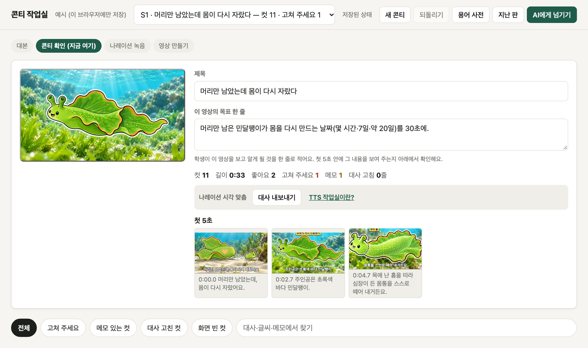

# 콘티 작업실 — 수업 영상을 컷마다 눈으로 보며 고치기

수업 영상과 학생 활동 영상을 만들 때, 렌더하기 전에 **컷마다 대사·화면·글씨·그림을 보며 고치는** 교사용 웹앱입니다.
고친 내용은 선생님 폴더의 콘티 파일에 저장되고, 쓰던 AI(Claude·Codex·Gemini 등)가 그 파일을 읽어 영상을 만듭니다.

**열기: https://n-lifescience.github.io/conti-studio/** (설치 없음 · PC의 크롬·엣지·웨일)



## 쓰는 순서

1. **대본** — 「새 콘티」에 대본을 붙여 넣으면 줄마다 컷이 생겨요. AI가 만든 콘티 폴더를 열어도 돼요.
2. **콘티 확인** — 컷마다 그림·영상·화면 글씨를 넣고 고쳐요. 글씨는 끌어서 옮기고 고칠 점은 메모로 남겨요.
3. **나레이션 녹음** — 「대사 내보내기」로 [TTS 작업실](https://github.com/N-lifescience/tts-studio)에 넣어 내 목소리로 녹음하고,
   TTS 작업실 내보내기 폴더를 「TTS 결과 불러오기」로 고르면 줄마다 실제 길이로 컷 시각이 맞춰져요. 컷마다 「듣기」로 들어 볼 수 있어요.
4. **영상 만들기** — 「AI에게 넘기기」의 글을 복사해 AI에게 보내요. AI는 [AI-GUIDE.md](AI-GUIDE.md)를 읽고 콘티대로 만들어요.

저장은 1초쯤 뒤 저절로 돼요(⌘S·Ctrl+S 로 바로). 저장할 때마다 바로 앞 판이 `conti/.history/` 에 남아 「지난 판」에서 되돌릴 수 있어요.
AI가 같은 파일을 고치면 작업실이 알아채고 다시 불러와요.

## 영상 폴더

```
효모 실험/
  script/V1.json   대본
  conti/V1.json    콘티(작업실이 고치는 파일)
  media/           그림·영상 — 여기 넣은 파일을 「+ 그림 넣기」「+ 영상 넣기」에서 골라요
  stills/V1/       AI가 만든 정지 화면(있으면 컷마다 완성 화면으로 보여요)
```

빈 폴더를 열어도 돼요. 형식은 [AI-GUIDE.md](AI-GUIDE.md)에 있어요.

## 개인정보

파일은 선생님 컴퓨터 밖으로 나가지 않아요. 로그인·서버 저장·방문 분석이 없어요. → [개인정보 안내](privacy.html)
학생 얼굴이 나오는 영상을 AI에게 넘길 때는 학교 동의 절차와 그 AI 서비스의 정책을 먼저 확인해 주세요.

## 고쳐 쓰기

선생님 수업에 맞게 마음껏 고쳐 쓰세요. 저장소를 내려받아 아래처럼 켜면 돼요.
쓰던 AI에게 이 저장소를 열어 주고 바꾸고 싶은 화면을 말해도 돼요. 고친 것을 다시 나누실 때는 먼저 연락 주세요.

```bash
node --test tests/        # 저장·지난 판·TTS 불러오기·예시 시험 (가짜 폴더로 돈다)
python3 -m http.server 7890   # 이 폴더에서 켜고 http://127.0.0.1:7890
```

화면은 빌드 없는 HTML·JS 입니다. `backend.js` 가 저장 방식(폴더·예시·내 컴퓨터 서버)을 맡고 `app.js` 가 화면을 그립니다.

## 라이선스

비영리 목적으로 가져다 쓰는 것은 자유, 재배포·수정 배포·영리 이용은 사전 허락 — [LICENSE](LICENSE).
만든 콘티 파일과 영상은 만든 사람의 것이에요. 예시(`demo/`) 자료의 출처는 [demo/바다 민달팽이 쇼츠/CREDITS.md](demo/바다%20민달팽이%20쇼츠/CREDITS.md)에 있어요.
